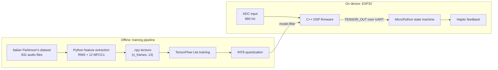

# Ri-So: Voice Loudness Sensor for Parkinson's Hypophonia

A wearable, real-time voice loudness sensor designed to detect **hypophonia** (abnormally quiet speech) in Parkinson's disease and give the wearer **haptic feedback** when their voice becomes too quiet.

This repository contains the **feature-extraction and on-device DSP layers** of the project: a C++ firmware pipeline that turns raw microphone samples into a 13-value feature tensor, and a Python pipeline that produces the *same* features from a clinical speech dataset so a TinyML model can be trained on them.

> Built at E-JUST as part of an IEEE EMBS.
> **Status: work in progress.** See [Project status](#project-status) for what is implemented and what is planned.

---

## Background

Parkinson's patients often speak too quietly without realising it (hypophonia), along with reduced vocal quality and difficulty keeping a consistent speech intensity. Ri-So aims to catch this in real time, on the body, without a laptop or cloud connection:

**extract voice features → train a TinyML model → deploy on an ESP32 with haptic feedback.**

## System overview



The planned device runs two layers in parallel:

1. **C++ DSP layer**: real-time acquisition and feature extraction.
2. **MicroPython decision layer**: listens to the C++ output and applies a quiet-streak state machine so the motor only fires on sustained quiet speech, not a single noisy frame.

## The feature set: 13 values per frame

| Index | Feature | What it captures |
|-------|---------|------------------|
| `0` | RMS energy | Overall loudness (the hypophonia signal) |
| `1-12` | 12 MFCCs | Spectral "fingerprint" of the voice on a perceptual mel scale |

MFCCs (Mel-Frequency Cepstral Coefficients) compress the spectrum the way human hearing does. Lower coefficients describe the broad spectral shape and low-frequency content, and higher ones add progressively finer spectral detail.

## DSP pipeline

Both implementations follow the same chain:

```
samples → Hann window → RMS energy ─────────────────────────┐
                    └→ FFT → power spectrum → mel filterbank → log → DCT → 12 MFCCs
                                                              │
                                         [RMS, MFCC1 … MFCC12] ← one 13-value tensor per frame
```

| Parameter | Value |
|-----------|-------|
| Frame size | 512 samples |
| Hop size | 256 samples (50% overlap) |
| Window | Hann |
| FFT | Radix-2 |
| Mel filters | 12, triangular |
| Output | 13 features per frame |

## Repository contents

| File | Description |
|------|-------------|
| [`hypophonia_DSP_01.cpp`](hypophonia_DSP_01.cpp) | Embedded firmware (Arduino framework). Dual-layer design: an acquisition loop fills a 512-sample ring buffer at 860 Hz, and a separate DSP stage runs every 256 samples and prints the feature tensor over serial. Includes a from-scratch radix-2 FFT with no platform-specific dependencies. |
| [`italian_parkinsons_extraction_v3.py`](italian_parkinsons_extraction_v3.py) | Offline pipeline that computes the same 13 features from the Italian Parkinson's Voice and Speech dataset, with MFCCs implemented manually (no librosa feature functions) to mirror the firmware math. |

## Getting started

### Python feature extraction

```bash
pip install numpy scipy librosa
```

1. Download the Italian Parkinson's Voice and Speech dataset.
2. Set `dataset_path` in `main()` of `italian_parkinsons_extraction_v3.py` to your download location.
3. Run:

```bash
python italian_parkinsons_extraction_v3.py
```

Labels are inferred from folder names (`28 people` → `PARKINSONS`, `healthy`/`control` → `HEALTHY`). For each processed file the script saves a `sample_XX_<LABEL>.npy` array of shape `(n_frames, 13)` and writes a summary to `extraction_metadata.json`. By default it processes a 20 + 20 file validation subset and prints mean RMS per class.

Per-frame layout:

```
[0]    RMS energy (dB)
[1-12] MFCCs
```

### C++ firmware

1. Open `hypophonia_DSP_01.cpp` in the Arduino IDE or PlatformIO and upload it to your board.
2. Open the Serial Monitor at **115200 baud**.
3. Each processed frame prints one line:

```
TENSOR_OUT:43.25,151.56,10.47,...,3.78
```

The firmware currently reads from a **built-in signal generator** (a 150 Hz tone plus noise) in place of a real ADC, so you can verify the whole pipeline on a bare board. Swapping in the real ADS1115 / microphone read is a one-function change (`readSimulatedADS1115()`).

## Design decision: 13 features on-device vs. clinical features offline

The project also considers a richer set of 19+ clinical voice features (F0, jitter, shimmer, HNR/NHR, and nonlinear measures such as RPDE, DFA, D2 and PPE) extracted with Praat. That approach is well suited to research, but it needs a laptop and heavy dependencies and cannot run on a microcontroller. The 13-feature MFCC + RMS set was chosen for the MVP because it is cheap enough to compute in real time on an ESP32 with minimal dependencies.

| | MVP (13 features) | Advanced (19+ features) |
|---|---|---|
| Runs in real time on ESP32 | Yes | No |
| Implementation | C++ DSP on device | Python + Praat, offline |
| Dependencies | Minimal | Praat, SciPy, NumPy |
| Intended use | Wearable device | Research and analysis |

## Decision logic (planned)

The MicroPython layer reads the `TENSOR_OUT` stream over UART and runs the model's prediction through a quiet-streak counter:

```python
if model_prediction == "QUIET":
    quiet_streak += 1
    if quiet_streak >= 2:      # ~600 ms of sustained quiet speech
        trigger_haptic()
        quiet_streak = 0
else:
    quiet_streak = 0
```

This suppresses false positives and ensures feedback is only triggered by quiet speech lasting roughly half a second or more. Optional extensions are SD-card logging and Bluetooth telemetry for clinician review.

## Project status

- [x] Python feature extraction (RMS + 12 MFCCs) on the Italian dataset
- [x] C++ DSP firmware: ring buffer, Hann window, radix-2 FFT, mel filterbank, DCT, serial tensor output
- [ ] Run firmware against a real ADC / e-skin microphone on the ESP32
- [ ] Extract features for the full dataset
- [ ] Train a TinyML classifier on the 13 features and quantize to INT8
- [ ] Embed `model.tflite` in the firmware
- [ ] Integrate the MicroPython state machine and haptic motor
- [ ] End-to-end testing, then prototype testing with patients

### Known gaps to close before training

The firmware and the Python pipeline are intended to be numerically equivalent, but they are not yet identical. These should be reconciled so the trained model sees the same feature distribution on device as in training:

- **RMS units:** the firmware outputs linear RMS (in mV), while the Python script outputs RMS in dB.
- **Mel range:** Python uses 80-3400 Hz at the dataset's native sample rate. At an 860 Hz sampling rate the firmware can only represent frequencies up to 430 Hz, so its filterbank (80 Hz to Nyquist) covers a different band.
- **Filter bin rounding:** the firmware rounds filter edges to the nearest FFT bin, whereas the Python script floors them.

## Acknowledgements

Built at the Egypt Japan University of Science and Technology (E-JUST) with IEEE EMBS. Speech data from the Italian Parkinson's Voice and Speech dataset.
